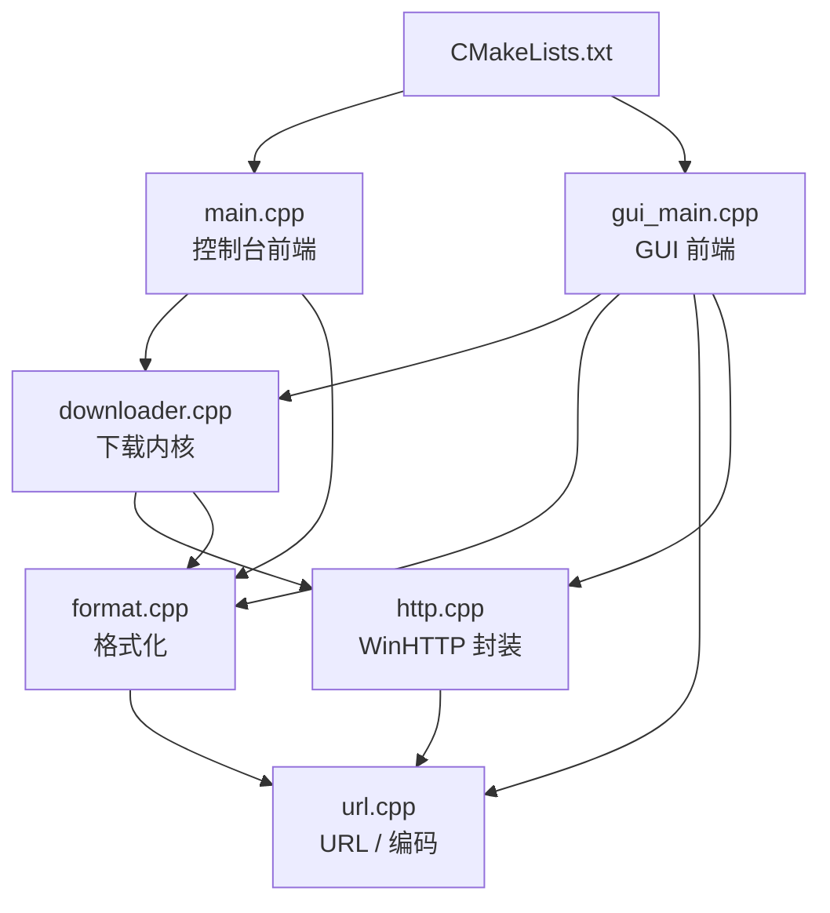
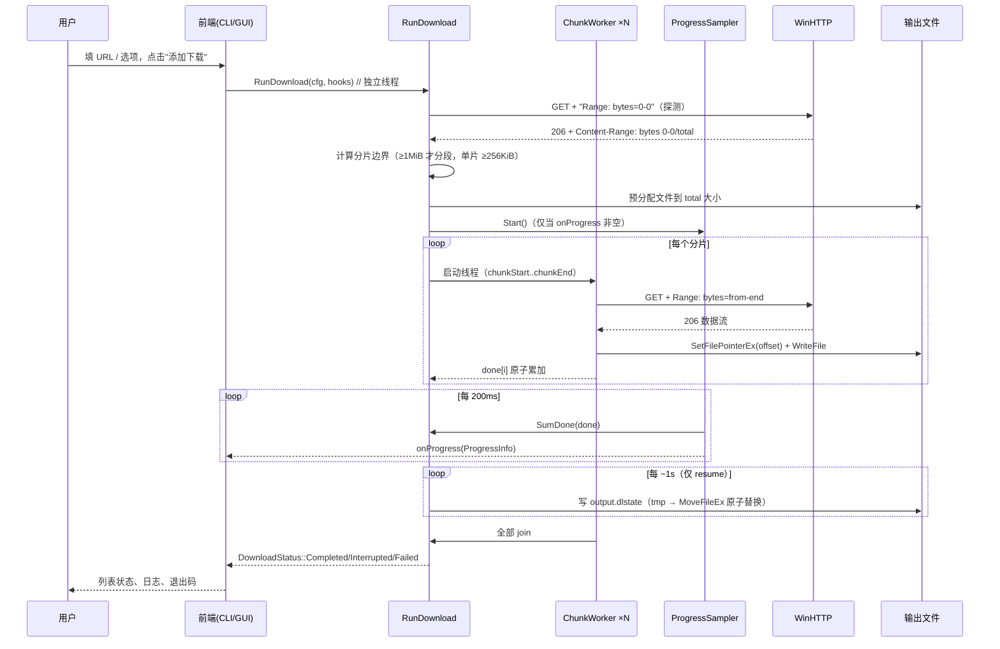
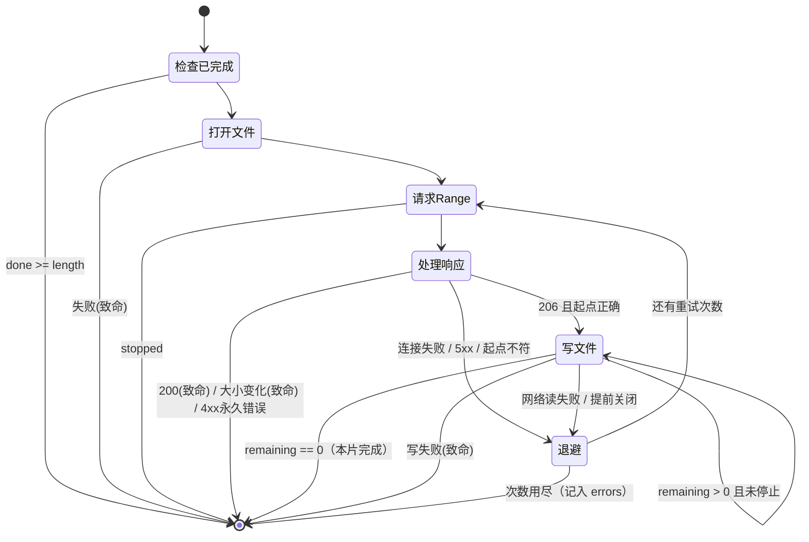
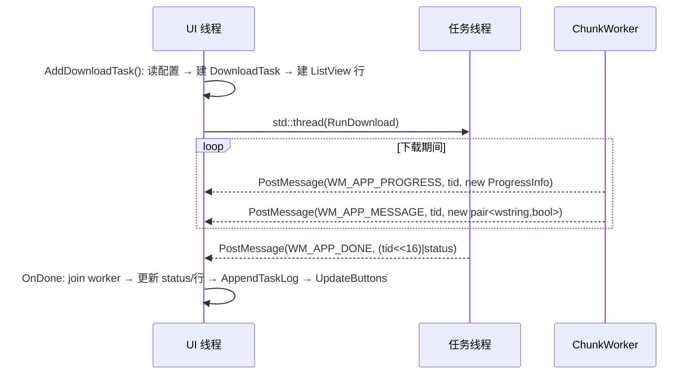
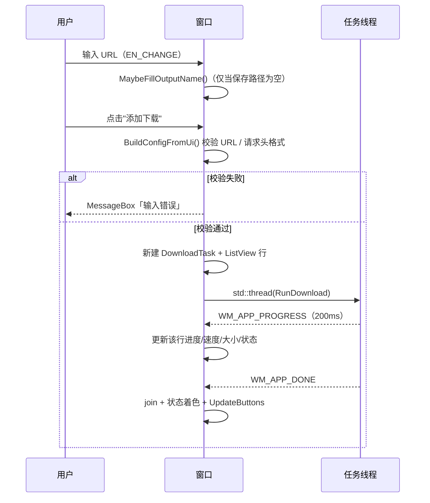

# cppdl 项目技术文档

#### 运行截图


> 纯 Win32 API + WinHTTP 的多线程文件下载器（C++17，零第三方依赖）

| 项目       | 内容                                                                                 |
| ---------- | ------------------------------------------------------------------------------------ |
| 项目名称   | cppdl（Console Downloader）                                                          |
| 版本       | 依据 `CMakeLists.txt` 与源码当前状态（2026-10-22）                                   |
| 语言标准   | C++17（`CMAKE_CXX_STANDARD 17` + `CXX_STANDARD_REQUIRED ON` + `CXX_EXTENSIONS OFF`） |
| 目标平台   | Windows 10 / 11（x64 / x86），Unicode（UTF-16 API + UTF-8 源码）                     |
| 构建系统   | CMake ≥ 3.16，支持 MSVC / MinGW-GCC / Clang+lld-link                                 |
| 可执行产物 | `cppdl.exe`（控制台）、`cppdl_gui.exe`（Win32 窗口）                                 |
| 第三方依赖 | 无（仅 Windows SDK：WinHTTP、comctl32、comdlg32、shell32）                           |
| 源码规模   | 6 个 `.cpp` + 4 个 `.h` + 1 个 `.rc` + 1 个 `.manifest`，合计约 3.9k 行              |

---

## 目录

1. [项目概览](#1-项目概览)
2. [技术栈与运行环境](#2-技术栈与运行环境)
3. [目录与文件清单](#3-目录与文件清单)
4. [总体架构](#4-总体架构)
5. [公共数据结构与 API](#5-公共数据结构与-api)
6. [模块详解](#6-模块详解)
7. [下载算法详解](#7-下载算法详解)
8. [断点续传机制](#8-断点续传机制)
9. [并发模型与线程安全](#9-并发模型与线程安全)
10. [GUI 设计与交互](#10-gui-设计与交互)
11. [CLI 参考](#11-cli-参考)
12. [构建与打包](#12-构建与打包)
13. [运行期文件](#13-运行期文件)
14. [错误处理与诊断](#14-错误处理与诊断)
15. [性能特征](#15-性能特征)
16. [已知限制](#16-已知限制)
17. [扩展指南](#17-扩展指南)
18. [附录](#18-附录)

---

## 1. 项目概览

### 1.1 是什么

cppdl 是一个**单文件级轻量下载引擎**，用纯 Windows 原生 API 实现了主流下载器的核心能力：多线程分段下载、断点续传、失败重试、代理与自定义请求头。它有两个前端，共用同一套下载内核：

| 前端            | 源文件             | 界面形态                    | 适用场景                         |
| --------------- | ------------------ | --------------------------- | -------------------------------- |
| `cppdl.exe`     | `src/main.cpp`     | 控制台，`\r` 原地刷新进度条 | 脚本化、批处理、快速下载         |
| `cppdl_gui.exe` | `src/gui_main.cpp` | Win32 原生窗口，多任务列表  | 日常交互使用，可同时管理多条任务 |

两个前端**不复制任何下载逻辑**：都只是构造 `DownloadConfig` + `DownloadHooks` 后调用 `RunDownload()`。

### 1.2 设计目标

| 目标               | 落地方式                                                                           |
| ------------------ | ---------------------------------------------------------------------------------- |
| 零第三方依赖       | 只用 Windows SDK 与 C++17 标准库，产物不依赖 VC++/MinGW 运行库（GCC 下静态链接）   |
| 下载核心与界面解耦 | `downloader.h` 只暴露 3 个函数 1 个回调结构；界面通过 `std::function` 回调接收进度 |
| 多任务互不干扰     | 每个任务持有独立的 `std::atomic<bool>` 停止标志，通过 `DownloadHooks` 指针注入内核 |
| 中断可续传         | `.dlstate` 状态文件 + 临时文件原子替换 + 五项一致性校验                            |
| 参数化程度高       | 线程数、重试次数、代理、User-Agent、任意请求头全部可配                             |
| 现代界面观感       | comctl32 v6 视觉样式 + Per-Monitor DPI + Segoe UI 字体体系                         |

### 1.3 特性清单

**下载能力**

- HTTP / HTTPS（WinHTTP，TLS 由系统 Schannel 提供）
- 多线程分段下载（Range 请求，HTTP 206）
- 自动降级：服务器不支持 Range 时回退单连接顺序下载
- 断点续传：`.dlstate` 记录每个分片完成字节数，中断/崩溃后继续
- 指数退避重试：250ms → 500ms → 1s → 2s → 4s → 8s（封顶 8s）
- 永久错误快速失败：4xx（除 408 / 429）不重试
- 大小校验：`Content-Range` 总长变化、响应长度不足、`Content-Range` 起点不符均有处理
- 空文件短路：总长 0 时直接创建空文件返回完成
- 自定义请求头 / User-Agent / HTTP 代理
- 平滑速度显示：最近 ~2 秒滑动窗口，200ms 采样

**界面能力**

- 控制台：真控制台用 `\r` 覆盖刷新；输出被重定向时降级为每 2 秒一行
- GUI：多条任务并发、逐任务日志、按钮状态联动、任务列表持久化（JSON）
- 关闭窗口时安全收尾：停止全部任务 → `join` 工作线程 → 保存任务列表

### 1.4 快速开始

```powershell
# 控制台版
.\cppdl.exe https://example.com/file.zip -t 16 -o D:\downloads\file.zip

# GUI 版（双击或命令行启动）
.\cppdl_gui.exe
```

构建见 [第 12 章](#12-构建与打包)。

---

## 2. 技术栈与运行环境

| 类别       | 选型                                                   | 说明                                                                                |
| ---------- | ------------------------------------------------------ | ----------------------------------------------------------------------------------- |
| 语言       | C++17                                                  | `std::thread` / `std::atomic` / `std::function` / `std::filesystem` / `std::chrono` |
| HTTP       | WinHTTP（`winhttp.dll`）                               | 同步阻塞 I/O，每线程独立 `HINTERNET` 句柄链                                         |
| 文件 I/O   | Win32 `CreateFileW` / `SetFilePointerEx` / `WriteFile` | 支持多线程随机写入同一文件                                                          |
| 窗口       | Win32 原生                                             | `WNDCLASSEXW` + `CreateWindowExW` + 自绘窗口过程                                    |
| 控件       | comctl32 v6                                            | ListView（报告视图）、UpDown 微调、Button、Edit、Static                             |
| 通用对话框 | comdlg32                                               | `GetSaveFileNameW`（"浏览…"）                                                       |
| 字符编码   | 源码 UTF-8 + 宽字符 API                                | `#pragma execution_character_set("utf-8")`（MSVC）、`/utf-8`、字符串统一 `wchar_t`  |
| GDI        | `CreateFontW` / `CreateSolidBrush`                     | GUI 主题字体与配色                                                                  |
| DPI        | `PerMonitorV2`（manifest）                             | 高 DPI 下由系统缩放，布局坐标为 96 DPI 基准                                         |
| 构建       | CMake 3.16+                                            | 同时产出 console 与 WIN32 两个 target                                               |

**链接库**

| 库         | 用途                                   |
| ---------- | -------------------------------------- |
| `winhttp`  | WinHTTP API                            |
| `comctl32` | ListView / UpDown / 视觉样式           |
| `comdlg32` | 另存为对话框                           |
| `shell32`  | `CommandLineToArgvW`（控制台参数解析） |

---

## 3. 目录与文件清单

```
file-download-cpp/
├── CMakeLists.txt              # 构建脚本（2 个 target，公共源 + 编译选项）
├── 构建.bat                    # Windows 一键构建（MinGW Makefiles + Release）
├── docs/
│   └── 项目文档.md             # 本文件
├── 屏幕截图 *.png              # 历史运行截图（控制台 / 旧版 GUI）
├── build/                      # 构建输出目录（由 cmake 生成，可安全删除）
└── src/
    ├── app.manifest            # comctl32 v6 + Per-Monitor DPI 清单
    ├── app.rc                  # 资源脚本：嵌入 cppdl.ico
    ├── cppdl.ico               # 应用图标
    ├── url.h / url.cpp         # URL 解析 + 默认文件名推导 + UTF-8 互转
    ├── format.h / format.cpp   # 纯函数：字节/速度/ETA/百分比格式化
    ├── http.h / http.cpp       # WinHTTP 封装（HttpStream）
    ├── downloader.h / .cpp     # 下载内核（分段、重试、续传、线程管理）
    ├── main.cpp                # 控制台前端（ConsoleUi）
    └── gui_main.cpp            # Win32 GUI 前端（多任务）
```

| 文件                      |      行数 | 职责                                                                       | 依赖                          |
| ------------------------- | --------: | -------------------------------------------------------------------------- | ----------------------------- |
| `url.h` / `url.cpp`       |  46 / 364 | `Url` 结构、`ParseUrl`、`DefaultFileNameFromUrl`、`NarrowUtf8`/`WidenUtf8` | 仅 Win32 编码 API             |
| `format.h` / `format.cpp` |   38 / 81 | 纯格式化函数，无状态、线程安全                                             | `url.h`（`WidenUtf8`）        |
| `http.h` / `http.cpp`     |  85 / 358 | `HttpOptions`/`HttpResult`/`HttpStream`/`FormatWin32Error`                 | `url.h`、winhttp              |
| `downloader.h` / `.cpp`   | 65 / 1003 | 下载编排：探测、分片、重试、续传、进度采样                                 | http、format                  |
| `main.cpp`                |       372 | 参数解析、控制台渲染、退出码                                               | downloader、format            |
| `gui_main.cpp`            |      1414 | 窗口、控件、任务池、JSON 持久化、UI 主题                                   | downloader、format、http、url |
| `app.rc` + `app.manifest` |    9 / 32 | 图标资源 + 视觉样式/DPI 清单                                               | —                             |
| `CMakeLists.txt`          |        39 | 构建定义                                                                   | —                             |

---

## 4. 总体架构

### 4.1 分层视图

```
┌──────────────────────────────────────────────────────────────┐
│  表现层（前端，二选一）                                        │
│  ┌────────────────────────┐   ┌─────────────────────────────┐ │
│  │ ConsoleUi (main.cpp)   │   │ WndProc + 控件 (gui_main)    │ │
│  │ \r 原地刷新 / 2s 降级   │   │ ListView / 日志 / 按钮状态   │ │
│  └───────────┬────────────┘   └──────────────┬──────────────┘ │
└──────────────┼───────────────────────────────┼────────────────┘
               │ DownloadHooks（onProgress / onMessage）
               │ DownloadConfig（URL / 路径 / 线程 / 重试 / HTTP）
┌──────────────▼───────────────────────────────▼────────────────┐
│  编排层  downloader.cpp                                        │
│  RunDownload：探测 → 分片 → 续传校验 → 预分配 → 启线程 → join  │
│  ProgressSampler（200ms）· ChunkWorker（N 个）· saver（1 个）    │
└──────────────┬───────────────────────────────┬────────────────┘
               │                               │
┌──────────────▼───────────┐      ┌────────────▼───────────────┐
│  传输层  http.cpp         │      │  工具层                     │
│  HttpStream::Open/Read    │      │  url.cpp（解析/文件名/编码）│
│  Content-Range 解析       │      │  format.cpp（格式化纯函数）  │
└──────────────┬───────────┘      └────────────────────────────┘
               │
┌──────────────▼────────────────────────────────────────────────┐
│  系统层  WinHTTP · Win32 文件 API · Win32 控件 · GDI           │
└───────────────────────────────────────────────────────────────┘
```

### 4.2 模块依赖



依赖方向严格单向：`url` ← `format`/`http` ← `downloader` ← 前端。**没有反向依赖**，因此下载内核可以脱离界面单独复用（例如未来做 DLL 或服务）。

### 4.3 端到端数据流



### 4.4 关键设计决策

| 决策                                 | 理由                                           | 代价 / 注意点                                       |
| ------------------------------------ | ---------------------------------------------- | --------------------------------------------------- |
| 同步 WinHTTP，每分片一线程           | 代码简单、无回调地狱；分段已提供并发度         | 线程数受文件大小与线程数参数限制；无 I/O 多路复用   |
| 每线程独立 `HttpStream`              | WinHTTP 句柄不做跨线程共享，避免加锁           | 每线程一次 TLS 握手开销                             |
| 进度用 `atomic<long long>` + relaxed | 只用于展示与落盘判定，不需要跨线程同步语义     | 读取值可能短暂滞后（可接受）                        |
| 每任务独立停止标志（指针注入）       | 多任务互不干扰；无标志时回退全局变量，兼容 CLI | 生命周期由前端保证（任务对象必须活到线程结束）      |
| 状态文件文本格式而非二进制           | 可直接用记事本查看排障，跨版本兼容容易         | 解析器需容错；文件略大（可忽略）                    |
| 先写 `.tmp` 再原子替换               | 崩溃时不会留下半截状态文件                     | 需要同目录（同一卷）才能原子 `MoveFileEx`           |
| GUI 用 `PostMessage` 跨线程          | 工作线程绝不触碰控件，符合 Win32 线程亲和性    | 载荷需堆分配，UI 线程负责释放（泄漏点需谨慎）       |
| GUI 只做"喂配置 + 显示"              | 不在 UI 层复制下载逻辑                         | 配置校验两次（UI 层 clamp + 内核层 clamp）          |
| 视觉主题通过 manifest 注入           | 一行清单换来全部控件主题化                     | 与链接器自动 manifest 冲突时必须走 `/MANIFESTINPUT` |

---

## 5. 公共数据结构与 API

### 5.1 `Url`（url.h）

```cpp
struct Url {
    bool secure = false;      // true => https（请求时带 WINHTTP_FLAG_SECURE）
    std::wstring host;        // 主机名或 IPv6 字面量（不含方括号）
    uint16_t port = 80;       // 显式端口覆盖默认值（https 默认 443）
    std::wstring path;        // 请求目标，至少 "/"，可能含查询串
    std::wstring raw;         // 去空白后的原始 URL（续传校验用）
};
```

字段全部宽字符，可直接喂给 WinHTTP；`path` 保留查询串是刻意设计——签名链接（OBS/S3/OSS）的参数必须原样发送。

### 5.2 `HttpOptions`（http.h）

| 字段               | 默认值         | 含义                                                                  |
| ------------------ | -------------- | --------------------------------------------------------------------- |
| `userAgent`        | `L"cppdl/1.0"` | 空值时 `Open` 内部回退到该值                                          |
| `proxy`            | 空             | `host:port`；空表示 `WINHTTP_ACCESS_TYPE_DEFAULT_PROXY`（走系统代理） |
| `headers`          | 空             | 每个元素形如 `"Key: Value"`，逐行拼接后随请求发送                     |
| `connectTimeoutMs` | 15000          | 解析 + 连接超时                                                       |
| `sendTimeoutMs`    | 30000          | 发送超时                                                              |
| `receiveTimeoutMs` | 30000          | 接收超时                                                              |

> `WinHttpSetTimeouts(session, resolve, connect, send, receive)` 的前两个参数都传 `connectTimeoutMs`，即解析与连接共用同一预算。

### 5.3 `HttpResult`（http.h）

| 字段            | 初值  | 含义                                |
| --------------- | ----- | ----------------------------------- |
| `status`        | 0     | HTTP 状态码（200 / 206 / 4xx …）    |
| `contentLength` | -1    | `Content-Length`，缺失或非法为 -1   |
| `rangeStart`    | -1    | `Content-Range` 起点（闭区间）      |
| `rangeEnd`      | -1    | `Content-Range` 终点（闭区间）      |
| `rangeTotal`    | -1    | 资源总长；`*` 或缺失为 -1           |
| `acceptRanges`  | false | `Accept-Ranges` 值中含 `bytes` 标记 |

### 5.4 `HttpStream`（http.h）

```cpp
class HttpStream {
public:
    HttpStream() = default;
    ~HttpStream();                                   // 自动 Close
    HttpStream(const HttpStream&) = delete;          // 句柄独占
    HttpStream& operator=(const HttpStream&) = delete;

    bool Open(const Url&, const HttpOptions&, const std::wstring& rangeHeader,
              HttpResult& result, std::wstring& err);
    bool Read(char* buffer, DWORD capacity, DWORD& got, std::wstring& err);
    void Close();                                    // 可重复调用
private:
    HINTERNET session_ = nullptr, connection_ = nullptr, request_ = nullptr;
};
```

约定：

- **一个实例只由一个线程使用**，内部无锁。
- `Open` 开头先 `Close()`，因此同一实例可复用（当前实现每次尝试新建实例，复用能力留给调用方）。
- `Read` 返回 `true && got == 0` 表示响应体正常结束。

### 5.5 `DownloadConfig` / `ProgressInfo` / `DownloadHooks` / `DownloadStatus`（downloader.h）

```cpp
struct DownloadConfig {
    Url url;
    std::wstring outputPath;
    int threads = 8;        // 期望连接数（内核会按文件大小再夹一次）
    int retries = 5;        // 每分片重试次数，总尝试次数 = retries + 1
    bool resume = true;     // 是否读写 .dlstate
    HttpOptions http;
};

struct ProgressInfo {
    long long done = 0;     // 已下载字节
    long long total = -1;   // 总字节，-1 未知
    double speedBps = 0.0;  // 平滑速度
    int active = 0;         // 当前活跃连接
    int workers = 1;        // 总连接数
};

struct DownloadHooks {
    std::function<void(const ProgressInfo&)> onProgress;
    std::function<void(const std::wstring&, bool isError)> onMessage;
    std::atomic<bool>* stopFlag = nullptr;        // 非空则优先使用
    std::atomic<bool>* interruptedFlag = nullptr; // 同上
};

enum class DownloadStatus { Completed, Interrupted, Failed };
```

> **回调契约**：`onProgress` / `onMessage` 在**工作线程上下文**触发，必须快速返回，禁止直接操作 UI（GUI 前端因此改用 `PostMessage` 转发）。

---

## 6. 模块详解

### 6.1 `url` 模块

#### `ParseUrl(input, out, err) -> bool`

解析流程：

1. `Trim` 首尾空白（空格 / `\t` / `\r` / `\n`）。
2. 查找 `://`，缺失 → `URL 必须以 http:// 或 https:// 开头`。
3. 协议名转小写后比较；`http` → `secure=false`，`https` → `secure=true`，其他 → `不支持的协议: xxx`（保留用户原始大小写）。
4. 截掉 `#` 及其后的片段（片段不发送给服务器）。
5. 在第一个 `/` 或 `?` 处切分 authority；路径缺失补 `/`；以 `?` 开头时补前导 `/`。
6. 端口：先填协议默认值（80/443），再看 authority：
   - `[` 开头 → IPv6 字面量，取 `]` 之间的内容，`]` 之后必须是 `:port`；
   - 否则用**最后一个** `:` 分隔端口（主机名本身不含冒号）。
7. `host` 为空 → `URL 缺少主机名`；成功后写 `raw = s`。

`ParsePort` 逐位累加，遇到非数字 → `URL 中的端口号非法`，超过 65535 → `URL 中的端口号超出范围`，`0` → 非法，空串 → `URL 中的端口号为空`。

支持形态：

| 输入                  | host    | port | path     |
| --------------------- | ------- | ---- | -------- |
| `https://a.com/x.zip` | `a.com` | 443  | `/x.zip` |
| `http://a.com:8080`   | `a.com` | 8080 | `/`      |
| `http://a.com?x=1`    | `a.com` | 80   | `/?x=1`  |
| `http://[::1]:8080/p` | `::1`   | 8080 | `/p`     |
| `http://a.com/p#frag` | `a.com` | 80   | `/p`     |

#### `DefaultFileNameFromUrl(rawUrl) -> wstring`

四层优先级（每层失败才继续下一层）：

1. 查询参数 `response-content-disposition` → 按 `Content-Disposition` 语法取文件名（对象存储签名链接场景）
2. 查询参数 `filename` / `fname` / `attname` / `download`（按此顺序首个非空者）
3. 路径最后一段（百分号解码）
4. 兜底 `download.bin`

后处理：`< > : " / \ | ? *` 与控制字符（`< 32`）替换为 `_`；反复删除结尾的 `.` 与空格；清洗后为空则回到 `download.bin`。

`Content-Disposition` 解析顺序：优先 `filename*=`（RFC 5987，形如 `UTF-8''%E6%96%87.bin`），剥离 `;` 之后内容 → 去引号 → 去掉 `''` 前缀 → 百分号解码；其次普通 `filename=`。

#### 编码工具

| 函数         | 行为                                          | 失败回退                           |
| ------------ | --------------------------------------------- | ---------------------------------- |
| `NarrowUtf8` | UTF-16 → UTF-8，先查长度再一次性分配          | 返回空串                           |
| `WidenUtf8`  | 严格 UTF-8 → UTF-16（`MB_ERR_INVALID_CHARS`） | 退回 `CP_ACP` 解释；再失败返回空串 |

### 6.2 `format` 模块

四个纯函数，无 I/O、无全局状态，可在任意线程调用。

| 函数                                  | 输入              | 输出示例                               | 规则                                             |
| ------------------------------------- | ----------------- | -------------------------------------- | ------------------------------------------------ |
| `FormatBytes(long long)`              | 字节数，负数=未知 | `0 B` / `1.50 KB` / `7.85 GB` / `未知` | 1024 进位，最多到 TB；B 用整数，其余两位小数     |
| `FormatSpeed(double)`                 | B/s               | `0 B/s` / `845.3 KB/s` / `93.1 MB/s`   | 非正数或 NaN 归零；B/s 取整，KB/MB 一位，GB 两位 |
| `FormatEta(double)`                   | 秒                | `01:08` / `1:02:03` / `--:--`          | 负数 / NaN / Inf → `--:--`；四舍五入到整秒       |
| `FormatPercent(long long, long long)` | part, total       | `42.5%` / `0%`                         | `total <= 0` 直接返回 `0%`                       |

### 6.3 `http` 模块

#### `HttpStream::Open` 内部步骤

```
Close() → 重置 result
  ↓
WinHttpOpen(UA, proxyType, proxyName|NO_PROXY, NO_PROXY_BYPASS, 0)   // 同步模式
  ↓ WinHttpSetTimeouts(connect, connect, send, receive)
WinHttpConnect(host, port, 0)
  ↓
EncodePath(url.path) → WinHttpOpenRequest(GET, path, HTTP/1.1, flag=SECURE?)
  ↓ 拼接附加头：Range（若有）+ opts.headers 每行 CRLF
WinHttpSendRequest(headers, len, NO_REQUEST_DATA, 0, 0, 0)
  ↓
WinHttpReceiveResponse
  ↓
WinHttpQueryHeaders(STATUS_CODE | FLAG_NUMBER)
  ↓
Content-Length → wcstoll（须读到数字且 >= 0）
Content-Range  → ParseContentRange（失败仅记 err，不算致命）
Accept-Ranges  → ContainsBytesToken（大小写不敏感匹配 "bytes"）
```

任一步骤失败都会 `Close()` 所有已创建句柄，`err` 写入中文描述 + `FormatWin32Error` 明细。

#### `Read` 语义

```
request_ == nullptr           → false, "HTTP 请求已关闭"
WinHttpQueryDataAvailable 失败 → false, "查询可读数据失败: ..."
available == 0                → true, got = 0（调用方视为响应体结束）
否则 toRead = min(available, capacity) → WinHttpReadData
```

#### `ParseContentRange`

支持的两种形态：

| 头值               | rangeStart | rangeEnd | rangeTotal |
| ------------------ | ---------- | -------- | ---------- |
| `bytes 0-499/1234` | 0          | 499      | 1234       |
| `bytes 0-499/*`    | 0          | 499      | -1         |
| `bytes */1234`     | -1         | -1       | 1234       |

校验：前缀必须是 `bytes`/`BYTES`；必须有 `/`；`end >= start`；已知总量时 `end < total`。

#### `EncodePath`

先 `NarrowUtf8` 转字节，再对 `byte <= 0x20 || byte >= 0x7F` 编码为 `%XX`（大写十六进制）；**已有的 `%` 与可打印 ASCII 原样保留**，因此不会对已编码路径二次编码。

#### `FormatWin32Error`

`FormatMessageW(FROM_SYSTEM)` → 失败再 `FROM_HMODULE(winhttp.dll)` → 仍失败返回 `错误码 N`，成功则 `Trim` 掉尾部换行。

### 6.4 `downloader` 模块

文件内部分区（自上而下）：

| 区块           | 内容                                                                                                                                      |
| -------------- | ----------------------------------------------------------------------------------------------------------------------------------------- |
| 常量与全局标志 | `kSegmentThreshold`、`kMinChunkSize`、`g_stop`、`g_interrupted`                                                                           |
| 标志访问辅助   | `IsStopped` / `RequestStop` / `IsInterrupted` / `MarkInterrupted`                                                                         |
| 控制台事件     | `CtrlHandler`                                                                                                                             |
| 消息输出       | `Info` / `Fail`（`Fail` 统一加 `错误: ` 前缀）                                                                                            |
| 进度采样       | `ProgressSampler`                                                                                                                         |
| 文件与状态     | `WriteAllBytes` / `ReadAllBytes` / `FileSizeEquals` / `PrepareOutputFile` / `ResumeState` / `ReadStateFile` / `SaveStateFile` / `SumDone` |
| 下载逻辑       | `IsPermanentStatus` / `Backoff` / `PrintSummary` / `WorkerContext` / `RecordFatal` / `ChunkWorker` / `RunSequential`                      |
| 对外接口       | `InstallInterruptHandler` / `RequestDownloadStop` / `RunDownload`                                                                         |

#### 标志访问的四层兜底

```cpp
inline bool IsStopped(const DownloadHooks& h) {
    return h.stopFlag ? h.stopFlag->load(std::memory_order_relaxed)
                      : g_stop.load(std::memory_order_relaxed);
}
```

| 场景       | 传入                      | 效果                                   |
| ---------- | ------------------------- | -------------------------------------- |
| GUI 多任务 | `&DownloadTask::stopFlag` | 停止只影响本任务                       |
| CLI 单任务 | `nullptr`                 | 回退进程级 `g_stop`（Ctrl+C 也能生效） |

`RunDownload` 开头只在**未提供 per-task 标志时**才重置全局标志，避免多任务互相清掉对方的停止请求。

#### `ProgressSampler`

```cpp
Provider provider_;              // () -> long long，取当前累计字节
std::deque<pair<time_point,long long>> samples;  // 滑动窗口
```

- **采样周期**：`cv_.wait_for(200ms, []{ return stopping_; })`，可被 `Stop()` 立刻唤醒。
- **窗口**：至少保留 2 个点，且只保留最近 2 秒内的点。
- **速度**：`(done - front.done) / (now - front.time)`，窗口 < 0.25s 时速度为 0（避免抖动），负速度夹到 0。
- **无回调时不启线程**：`Start()` 里 `if (callback_)` 才创建，CLI/GUI 都提供回调所以总会启动。
- `Stop()` 幂等，通过 `stopped_` 标记保证只 `join` 一次。

#### 文件操作

| 函数                | 关键点                                                                                                                |
| ------------------- | --------------------------------------------------------------------------------------------------------------------- |
| `WriteAllBytes`     | `CREATE_ALWAYS` 覆盖创建；`WriteFile` 必须写满；`FlushFileBuffers` 刷盘                                               |
| `ReadAllBytes`      | 只接受 `1 B ~ 64 MiB`，超出视为无效（防异常文件耗尽内存）                                                             |
| `FileSizeEquals`    | `GetFileAttributesExW` + 高低 32 位拼 64 位                                                                           |
| `PrepareOutputFile` | `OPEN_ALWAYS`；`keepExisting && 大小已等于 total` 直接复用；否则截断为 0 再扩展到 total（得到可随机写入的预分配文件） |

#### `ChunkWorker` 状态机

```
读 done = done[i]
  ├─ done >= length  → 直接 return（该片已完成）
打开输出文件（OPEN_EXISTING，共享读写）
  ├─ 失败 → RecordFatal("打开输出文件失败") → return
for attempt in 0..retries:
  ├─ stopped()            → break
  ├─ done >= length       → break
  ├─ from = chunkStart + done；Range: bytes=from-chunkEnd
  ├─ Open 失败            → 记 lastError；还有次数 → Backoff；continue
  ├─ status == 200        → RecordFatal("服务器忽略了 Range 请求")   // 无法分段
  ├─ status != 206        → 4xx(非408/429) → break；否则 Backoff + continue
  ├─ rangeTotal != total  → RecordFatal("文件大小已变化")
  ├─ rangeStart != from   → 记错误 + Backoff + continue
  ├─ SetFilePointerEx(from)
  ├─ active += 1
  ├─ while remaining > 0 && !stopped():
  │     Read（失败 → ok=false, break）
  │     got == 0 → "连接在数据接收完成前关闭"
  │     WriteFile（不完整 → writeFailed=true, break）
  │     done += got; done[i].store(done, relaxed)
  ├─ active -= 1
  ├─ ok && remaining == 0 → CloseHandle; return（本片完成）
  ├─ writeFailed          → RecordFatal; break
  └─ 还有次数 → Backoff
收尾：CloseHandle；若未被停止 → errors.push_back("分片 k 失败: ...")
```

`RecordFatal` 只保留**第一条**致命错误（`fatal` 为空时才写），并立即置位本任务的停止标志，让其他分片尽快退出。

#### `RunDownload` 主流程

| 步骤 | 行为                                                              | 失败结果                                 |
| ---- | ----------------------------------------------------------------- | ---------------------------------------- |
| 0    | 条件重置全局标志；`InstallInterruptHandler()`；输出 `目标: <url>` | —                                        |
| 1    | `Open(range="bytes=0-0")` 探测                                    | `Failed`（附错误原因）                   |
| 2    | 探测期间被停止                                                    | `Interrupted`                            |
| 3    | 状态码分流（见 7.2）                                              | 401/407/416 等直接 `Failed` 并给中文原因 |
| 4    | `total == 0`                                                      | 创建空文件 → `Completed`                 |
| 5    | 不支持 Range 或长度未知                                           | 转 `RunSequential`                       |
| 6    | 计算分片（见 7.3）                                                | —                                        |
| 7    | 读取 `.dlstate` 并五项校验                                        | 不匹配则删除状态文件                     |
| 8    | `PrepareOutputFile(total, resumed)`                               | `Failed`                                 |
| 9    | 若 `SumDone >= total` → 删除状态、打印摘要                        | `Completed`（秒完成）                    |
| 10   | `resume` 时启动 saver 线程（每 ~1s、有变化才写）                  | —                                        |
| 11   | 启动 N 个 `ChunkWorker` + `ProgressSampler`                       | 线程创建失败 → 停止并 `Failed`           |
| 12   | `join` 全部；停止 sampler / saver                                 | —                                        |
| 13   | 分流收尾（见 7.8）                                                | —                                        |

#### `RunSequential`（不支持 Range 的回退）

- 先 `DeleteFileW(.dlstate)`：**单连接模式不支持续传**。
- `CREATE_ALWAYS` 覆盖创建；已知 `total` 时预分配。
- 每次重试前：回到开头 → 截断 → 重新预分配 → `done = 0`（进度归零，日志会看到百分比跳回 0）。
- 长度校验：`Content-Length` 与探测结果不一致 → 直接失败；读取结束后实际字节数与期望不符 → 重试。
- 成功后 `SetEndOfFile(written)` 截掉预分配的多余空间。

#### 摘要输出

```
下载完成: D:\downloads\a.gguf  (7.85 GB, 32 个连接, 86.3 秒, 平均 93.1 MB/s)
```

`total <= 0` 时省略大小与平均速度。

### 6.5 `main.cpp`（控制台前端）

| 组件                   | 职责                                                              |
| ---------------------- | ----------------------------------------------------------------- |
| `kUsage`               | 帮助文本（编译期拼接的宽字符串常量）                              |
| `Print` / `PrintError` | 宽字符 → UTF-8 → `stdout` / `stderr`，逐行 `fflush`               |
| `ParseInt`             | `wcstol` + 尾部检查 + `±1000000` 范围检查                         |
| `AutoThreadCount`      | `clamp(2 × 逻辑核数, 4, 32)`，探测失败按 4 核                     |
| `IsConsoleOutput`      | `GetConsoleMode` 成功即真控制台                                   |
| `BuildProgressLine`    | 24 格进度条 + 百分比 + 大小 + 速度 + ETA + `conn a/w`             |
| `ConsoleUi`            | 互斥锁串行化输出；`\r` 覆盖刷新 + 空格擦除残留；重定向时 2 秒一行 |

进度行样式（总量已知）：

```
[###############>--------]  63.2%  4.96 GB / 7.85 GB  93.1 MB/s  ETA 00:31  conn 32/32
```

未知总量时：`1.80 GB  91.3 MB/s  conn 1/1`。

### 6.6 `gui_main.cpp`（GUI 前端）

单文件，约 1400 行，分区如下：

| 区块       | 内容                                                                                                                                            |
| ---------- | ----------------------------------------------------------------------------------------------------------------------------------------------- |
| 常量与消息 | `IDI_APPICON`、`WM_APP_PROGRESS/MESSAGE/DONE`                                                                                                   |
| 控件 ID    | `IDC_*`（101…116）                                                                                                                              |
| 任务结构   | `DownloadTask` + `g_tasks`（`vector<unique_ptr<DownloadTask>>`）                                                                                |
| 主题       | 调色板常量、`g_hFont` / `g_hFontBold` / `g_hFontMono` / `g_hbrBg`                                                                               |
| 工具函数   | `GetText` / `Trim` / `ToLower` / `EditInt` / `AutoThreadCount` / `StatusToText` / `FindTaskIndex` / `BuildConfigFromUi` / `MaybeFillOutputName` |
| ListView   | `ListViewAddColumn` / `ListViewAddRow` / `ListViewUpdateRow` / `GetSelectedTaskId`                                                              |
| 日志       | `AppendTaskLog` / `RefreshLogFromSelection`                                                                                                     |
| 按钮联动   | `UpdateButtons`                                                                                                                                 |
| 持久化     | `StateFilePath` / `JsonEscape` / `SaveTasks` / 四个 `GetJson*` / `LoadTasks`                                                                    |
| 任务操作   | `AddDownloadTask` / `StopSelectedTask` / `RemoveSelectedTask` / `ResumeSelectedTask`                                                            |
| 消息处理   | `OnProgress` / `OnMessage` / `OnDone`                                                                                                           |
| 界面       | `CreateThemeObjects` / `MakeControl` / `MakeLabel` / `MakeGroupTitle` / `CreateControls` / `LayoutControls` / `BrowseOutput`                    |
| 窗口过程   | `WndProc` + `wWinMain`                                                                                                                          |

详见 [第 10 章](#10-gui-设计与交互)。

---

## 7. 下载算法详解

### 7.1 探测阶段

用 `Range: bytes=0-0` 发一次 GET，目的是**用一个请求同时拿到三件事**：资源是否支持 Range、总长度、以及服务器可达性。

```
probe = Open(range = "bytes=0-0")
```

判定"支持分段"的条件非常严格：

```cpp
rangeSupported = probe.status == 206 && probe.rangeStart == 0 &&
                 probe.rangeEnd == 0 && probe.rangeTotal > 0;
```

只返回 206 但不带合法 `Content-Range`、或总长未知，都视为**不支持**，走单连接。

### 7.2 探测状态码判定矩阵

| status                       | 条件              | 处理                                            |
| ---------------------------- | ----------------- | ----------------------------------------------- |
| —                            | `Open` 失败       | `Failed`，输出底层错误                          |
| 401                          | 需要认证          | `Failed`：「服务器要求身份认证（HTTP 401）」    |
| 407                          | 代理需要认证      | `Failed`：「代理要求身份认证（HTTP 407）」      |
| 416                          | `rangeTotal == 0` | 创建空文件 → `Completed`                        |
| 416                          | 其他              | `Failed`：「服务器拒绝 Range 探测（HTTP 416）」 |
| ≥ 400 或 ∉ {200, 206}        | —                 | `Failed`：「服务器返回 HTTP N」                 |
| 206 且 0-0 合法              | —                 | 分段下载，`total = rangeTotal`                  |
| 200 且 `Content-Length >= 0` | —                 | 单连接下载，`total = contentLength`             |
| 200 且无长度                 | —                 | 单连接下载，`total = -1`（仅显示已下载量）      |

### 7.3 分片计算

```cpp
constexpr long long kSegmentThreshold = 1LL << 20;   // 1 MiB
constexpr long long kMinChunkSize     = 256 * 1024;  // 256 KiB

workers = max(1, cfg.threads);
if (total < kSegmentThreshold) {
    workers = 1;                                     // 小文件不切
} else {
    byMinChunk = max(1LL, total / kMinChunkSize);     // 最多能切几片
    workers = min<long long>(workers, byMinChunk);
}
chunkSize = (total + workers - 1) / workers;          // 向上取整
workers   = (total + chunkSize - 1) / chunkSize;      // 按实际片长回算（处理末片偏小）
starts[i] = i * chunkSize;
ends[i]   = min(total - 1, starts[i] + chunkSize - 1);
```

示例（`total = 8,000,000`，`threads = 16`）：

| 计算           | 值                               |
| -------------- | -------------------------------- |
| `byMinChunk`   | `8000000 / 262144 = 30`          |
| `workers`      | `min(16, 30) = 16`               |
| `chunkSize`    | `ceil(8000000/16) = 500000`      |
| 回算 `workers` | `ceil(8000000/500000) = 16`      |
| 分片           | `[0,499999] … [7500000,7999999]` |

### 7.4 分片线程状态机



### 7.5 重试与退避

```cpp
int delay = 250 << min(attempt, 5);   // 位移封顶 5，防溢出
if (delay > 8000) delay = 8000;
for (waited = 0; waited < delay && !stopped(); waited += 100)
    sleep_for(100ms);
```

| attempt | 0      | 1      | 2   | 3   | 4   | ≥5  |
| ------- | ------ | ------ | --- | --- | --- | --- |
| 等待    | 250 ms | 500 ms | 1 s | 2 s | 4 s | 8 s |

**退避期间每 100ms 检查停止标志**，因此"停止"最多延迟 100ms 生效。

`IsPermanentStatus(status)`：`400 ≤ status < 500 && status != 408 && status != 429` → 不重试。408（请求超时）与 429（限流）属于可恢复，继续退避。

### 7.6 单连接回退

触发条件：探测未通过 `rangeSupported`，**或** `total < 0`（长度未知）。

特点对比：

| 维度     | 分段模式               | 单连接模式                     |
| -------- | ---------------------- | ------------------------------ |
| 并发     | N 个线程               | 1 个连接                       |
| 断点续传 | 支持（`.dlstate`）     | **不支持**（重跑从头开始）     |
| 进度粒度 | 各分片累加             | 单一 `done`                    |
| 重试     | 分片级，保留已完成部分 | 整体重来（文件截断重新写）     |
| 完成校验 | `SumDone >= total`     | 实际字节数 == `Content-Length` |

### 7.7 进度采样与速度平滑

- 采样线程只在 `onProgress` 非空时创建；周期 200ms。
- 滑动窗口 ≥ 2 个采样点、跨度 ∈ [0.25s, 2s]。
- 速度 = 窗口内增量 / 窗口时长；窗口过短或进度回退时为 0。
- `active` 由各分片 `fetch_add/fetch_sub` 维护，仅用于展示。

界面侧展示节奏：CLI 每 200ms 重绘一行；GUI 每条 `WM_APP_PROGRESS` 更新对应 ListView 行（ListView 自身有重绘抑制，压力可控）。

### 7.8 完成 / 失败判定

收尾顺序（分段模式）：

```
threadCreateFailed?        → persistState(); Failed("创建下载线程失败")
IsInterrupted(hooks)?      → persistState(); Interrupted("已中断。重新执行相同命令即可续传")
fatal 非空?                → persistState(); Failed(fatal)
SumDone(done) >= total?    → DeleteFile(.dlstate); Completed + 摘要
否则                       → persistState(); 输出前 5 条分片错误; Failed
```

> 细节：`persistState()` 在 `resume == false` 时改为删除状态文件，行为与"未启用续传"一致。

---

## 8. 断点续传机制

### 8.1 状态文件

路径：`{outputPath}.dlstate`（与输出文件同目录、同卷）。

```
CPPDL-STATE 1
url https://example.com/file.bin
size 8000000
chunk 500000
count 16
0 500000
1 500000
2 412345
...
15 0
```

| 行                  | 含义                                                    |
| ------------------- | ------------------------------------------------------- |
| `CPPDL-STATE 1`     | 魔数 + 版本，首行不匹配直接视为无效                     |
| `url <utf8>`        | 原始 URL（`Url::raw`），防止误用其他任务的状态          |
| `size <total>`      | 文件总字节数                                            |
| `chunk <chunkSize>` | 分片大小，方案变化则旧状态作废                          |
| `count <n>`         | 分片数（解析时不强制校验，实际以条目最大下标 + 1 为准） |
| `<index> <done>`    | 第 index 片已完成字节（0 基，闭区间语义）               |

### 8.2 五项一致性校验

全部满足才允许续传，否则删除状态文件当作全新下载：

```cpp
ReadStateFile(statePath, state)
  && state.url       == cfg.url.raw
  && state.total     == total
  && state.chunkSize == chunkSize
  && state.done.size() == workers
  && FileSizeEquals(cfg.outputPath, total)
```

恢复时对每片做夹取：

```cpp
value = max(0LL, min(state.done[i], length));   // 防损坏数据越界
done[i].store(value, relaxed);
```

并输出提示：`发现未完成的下载，从断点继续（已完成 63.2%）。`

### 8.3 写入时机与原子性

| 时机                       | 行为                                                                 |
| -------------------------- | -------------------------------------------------------------------- |
| 下载中                     | saver 线程每 ~1 秒检查一次，**进度有变化才写盘**（`lastSaved` 比对） |
| 中断 / 失败 / 线程创建失败 | `persistState()` 立即写一次                                          |
| 全部完成                   | 删除 `.dlstate`                                                      |
| 状态不匹配                 | 删除旧状态                                                           |

原子写入算法：

```
写 {path}.dlstate.tmp（WriteFile + FlushFileBuffers）
   ↓ 成功
MoveFileExW(tmp → path, REPLACE_EXISTING | WRITE_THROUGH)
   ↓ 失败
删除 tmp
```

因此任何时刻磁盘上要么是完整的旧状态，要么是完整的新状态；崩溃最多留下 `.tmp` 残留（下次被忽略）。

### 8.4 失效场景速查

| 场景                             | 结果     | 原因                         |
| -------------------------------- | -------- | ---------------------------- |
| 换了 URL（哪怕同文件）           | 重新下载 | `url` 不匹配                 |
| 服务器文件大小变了               | 重新下载 | `total` 不匹配               |
| 改了线程数导致分片方案变化       | 重新下载 | `chunkSize` / 片数不匹配     |
| 手动删了输出文件                 | 重新下载 | `FileSizeEquals` 失败        |
| 手动改小了输出文件               | 重新下载 | 文件大小不等于 `total`       |
| 单连接模式（服务器不支持 Range） | 无法续传 | `RunSequential` 开头即删状态 |
| 勾掉"断点续传"                   | 无法续传 | `resume == false` 时删除状态 |

---

## 9. 并发模型与线程安全

### 9.1 单任务线程清单

| 线程                      | 数量                  | 生命周期                                                   | 职责                          |
| ------------------------- | --------------------- | ---------------------------------------------------------- | ----------------------------- |
| 调用线程（`RunDownload`） | 1                     | 阻塞到任务结束                                             | 探测、分片、启停、汇总        |
| `ChunkWorker`             | 0 ~ N                 | `total < 1MiB` 时为 1，其余为 `min(threads, total/256KiB)` | 各自负责一段 Range            |
| `ProgressSampler`         | 1（有回调时）         | `Start()` → `Stop()`                                       | 200ms 采样 + 回调             |
| 状态保存线程 saver        | 0 或 1（仅 `resume`） | 启动 → `saverStop`                                         | 每秒按需落盘                  |
| GUI 任务线程              | 1 / 任务              | `AddDownloadTask` → `join`                                 | 一条任务的 `RunDownload` 外壳 |

GUI 有 M 条任务时，总线程数 ≈ `M × (1 + N + 1 + 1)`。任务之间除进程级兜底原子量外**没有任何共享状态**。

### 9.2 同步原语与保护对象

| 数据                | 类型                           | 同步方式                    | 为什么够用                            |
| ------------------- | ------------------------------ | --------------------------- | ------------------------------------- |
| `done[i]`           | `vector<atomic<long long>>`    | relaxed load/store          | 只用于显示与完成判定                  |
| `active`            | `atomic<int>`                  | relaxed `fetch_add/sub`     | 纯计数                                |
| `errors` / `fatal`  | `vector<wstring>` / `wstring`  | `std::mutex` + `lock_guard` | 仅在失败路径争用，开销可忽略          |
| `stopping_` / `cv_` | `mutex` + `condition_variable` | 谓词等待                    | 需要可中断的 200ms 睡眠               |
| `saverStop`         | `atomic<bool>`                 | relaxed                     | 单向停止信号                          |
| `stopped_`          | `bool`                         | 约定只由控制线程调用        | `Stop()` 先后由同一线程调用两次也安全 |
| `g_tasks` / 控件    | —                              | 仅 UI 线程访问              | 工作线程通过 `PostMessage` 投递       |

**内存序选择的统一理由**：这些变量都是"单写多读或纯计数"，不承担发布其他内存写入的职责。用 `relaxed` 足以保证最终可见性与原子性，同时避免不必要的屏障开销。若未来引入"以进度为信号触发其他数据可见性"的逻辑，必须改成 `release/acquire`。

`Stop()` 与采样线程之间用 `mutex` + `cv` 而非 `sleep_for`，是为了让"停止"立即生效而不是最多等 200ms。

### 9.3 启动与关闭时序（GUI 单任务）



关闭窗口（`WM_CLOSE`）：

```
遍历 g_tasks：running 的任务 → interruptedFlag = true, stopFlag = true
遍历 g_tasks：worker.joinable() → join()（等 .dlstate 落盘完成）
SaveTasks() → g_tasks.clear() → DestroyWindow
```

### 9.4 线程安全的边界与风险点

| 风险                    | 现状                                                         | 说明                                                               |
| ----------------------- | ------------------------------------------------------------ | ------------------------------------------------------------------ |
| `DownloadTask` 生命周期 | 由 `unique_ptr` 在 `g_tasks` 中持有，`join` 后才允许 `erase` | 运行中的任务无法被"移除"（`RemoveSelectedTask` 有 `running` 检查） |
| 堆载荷泄漏              | `PostMessage` 失败时发送方 `delete`                          | 窗口销毁后不再有消息，泄漏窗口极小                                 |
| UI 线程阻塞             | `OnDone` 里 `join()`                                         | 该线程已完成 `RunDownload`，`join` 立即返回（仍需注意极端情况）    |
| `hooks` 拷贝            | 以值捕获进线程 lambda                                        | 内部只持有指针与 `std::function`，任务对象必须活到线程结束         |
| 全局兜底标志            | 仅当 `stopFlag == nullptr` 时使用                            | GUI 全部传指针，CLI 走全局                                         |

---

## 10. GUI 设计与交互

### 10.1 窗口与主题

| 项         | 值                                                                      |
| ---------- | ----------------------------------------------------------------------- |
| 窗口类名   | `cppdl_gui_window`                                                      |
| 标题       | `cppdl 多线程下载器（多任务版）`                                        |
| 初始客户区 | 620 × 640                                                               |
| 最小客户区 | 540 × 620（`WM_GETMINMAXINFO` + `AdjustWindowRectEx`）                  |
| 背景色     | `RGB(243,244,246)`（浅灰）                                              |
| 正文色     | `RGB(31,41,55)`（近黑）                                                 |
| 标签色     | `RGB(75,85,99)`（中灰）                                                 |
| 状态色     | 完成 `RGB(22,128,80)` · 失败 `RGB(200,40,40)` · 下载中 `RGB(20,90,180)` |
| 字体       | Segoe UI 12px（-12 逻辑高度）/ SemiBold（分组标题）/ Consolas（日志）   |
| 视觉样式   | `app.manifest` 依赖 comctl32 v6 + `PerMonitorV2` DPI                    |

`WM_CTLCOLORSTATIC` / `WM_CTLCOLOREDIT` / `WM_ERASEBKGND` 三个消息共同实现配色；日志框虽为只读 `EDIT`（走 `CTLCOLORSTATIC`），单独返回白底以保持"输入区"观感。

### 10.2 控件清单

| 控件 ID            |   值 | 类 / 样式                 | 说明                                                |
| ------------------ | ---: | ------------------------- | --------------------------------------------------- |
| `IDC_URL`          |  101 | `EDIT` + `ES_AUTOHSCROLL` | 下载地址，`EN_CHANGE` 时自动推导文件名              |
| `IDC_OUTPUT`       |  102 | `EDIT`                    | 保存路径（含文件名）                                |
| `IDC_BROWSE`       |  103 | `BUTTON`                  | 「浏览...」→ `GetSaveFileNameW`                     |
| `IDC_THREADS`      |  104 | `EDIT` + `ES_NUMBER`      | 线程数，1..64（UpDown 限制）                        |
| `IDC_THREADS_SPIN` |  105 | `UPDOWN_CLASSW`           | 与线程数编辑框 buddy，默认 `AutoThreadCount()`      |
| `IDC_RETRY`        |  106 | `EDIT` + `ES_NUMBER`      | 重试次数，0..100，默认 5                            |
| `IDC_RETRY_SPIN`   |  107 | `UPDOWN_CLASSW`           | 与重试编辑框 buddy                                  |
| `IDC_PROXY`        |  108 | `EDIT`                    | 代理 `host:port`，可带 `http://` 前缀（保存前剥离） |
| `IDC_HEADERS`      |  109 | `EDIT` 多行               | 每行 `Key: Value`，`User-Agent` 单独提取            |
| `IDC_RESUME`       |  110 | `BS_AUTOCHECKBOX`         | 断点续传，默认勾选                                  |
| `IDC_ADD`          |  111 | `BS_DEFPUSHBUTTON`        | 「添加下载」，回车默认按钮                          |
| `IDC_STOP`         |  112 | `BUTTON`                  | 停止选中任务                                        |
| `IDC_RETRY_TASK`   |  113 | `BUTTON`                  | 「继续」重启已停止/失败任务                         |
| `IDC_REMOVE`       |  114 | `BUTTON`                  | 移除已结束任务                                      |
| `IDC_LIST`         |  115 | `WC_LISTVIEWW` 报告视图   | 任务列表，扩展样式 `FULLROWSELECT \| DOUBLEBUFFER`  |
| `IDC_LOG`          |  116 | `EDIT` 只读多行           | 选中任务日志（Consolas）                            |

ListView 列：

| 列号 | 标题            | 初始宽 | 内容                                          |
| ---: | --------------- | -----: | --------------------------------------------- |
|    0 | 文件名          |    190 | `outputPath` 的 basename                      |
|    1 | 进度            |     76 | `63.2%` / `下载中` / `连接中...`              |
|    2 | 速度            |     88 | `93.1 MB/s`                                   |
|    3 | 已下载 / 总大小 |    150 | `4.96 GB / 7.85 GB`，总长未知显示 `x / 未知`  |
|    4 | 状态            |    100 | `下载中 32/32` / `已完成` / `已停止` / `失败` |

### 10.3 布局与响应式规则

96 DPI 基准坐标（`kMargin = 16`，`kLabelX = 34`，`kFieldX = 106`）：

| 元素               |          x |    y | w           |                    h |
| ------------------ | ---------: | ---: | ----------- | -------------------: |
| 分组框「下载设置」 |         16 |   12 | `W - 32`    |                  220 |
| URL 编辑框         |        106 |   34 | `W - 138`   |                   26 |
| 保存到编辑框       |        106 |   66 | `W - 218`   |                   26 |
| 浏览按钮           |  `W - 104` |   66 | 88          |                   26 |
| 线程数             |        106 |   98 | 60          |                   26 |
| 重试               |        226 |   98 | 60          |                   26 |
| 代理               |        350 |   98 | `W - 366`   |                   26 |
| 请求头             |        106 |  130 | `W - 138`   |                   58 |
| 断点续传           |        106 |  198 | 110         |                   20 |
| 四个按钮           | 由右向左排 |  244 | 96/84/84/76 |                   32 |
| ListView           |         16 |  290 | `W - 32`    |          170（固定） |
| 日志框             |         16 |  470 | `W - 32`    | `H - 486`（最小 60） |

按钮从右往左：`移除` → `继续` → `停止` → `添加下载`，间距 8px；这样窗口变窄时按钮仍贴右边，不会挤压输入框。

`LayoutControls` 在 `WM_SIZE` 与启动时各调用一次，所有坐标在函数内重新计算，无全局布局缓存。

### 10.4 按钮状态机

`UpdateButtons()` 依据"当前选中行的任务是否运行中"切换启用状态：

| 选中状态      | 添加  | 停止  | 继续  | 移除  |
| ------------- | :---: | :---: | :---: | :---: |
| 无选中        |   ✅   |   ❌   |   ❌   |   ❌   |
| 运行中        |   ✅   |   ✅   |   ❌   |   ❌   |
| 已停止 / 失败 |   ✅   |   ❌   |   ✅   |   ✅   |
| 已完成        |   ✅   |   ❌   |   ✅   |   ✅   |

触发点：`LVN_ITEMCHANGED`（经 `WM_NOTIFY`，**不是** `WM_COMMAND`）、任务添加、任务结束（`OnDone`）、任务移除。

### 10.5 跨线程消息协议

| 消息              | 值           | wParam                     | lParam                   | UI 侧处理                              |
| ----------------- | ------------ | -------------------------- | ------------------------ | -------------------------------------- |
| `WM_APP_PROGRESS` | `WM_APP + 1` | taskID                     | `new ProgressInfo`       | `OnProgress` 更新行，`unique_ptr` 释放 |
| `WM_APP_MESSAGE`  | `WM_APP + 2` | taskID                     | `new pair<wstring,bool>` | `OnMessage` 追加日志                   |
| `WM_APP_DONE`     | `WM_APP + 3` | `(taskID << 16) \| status` | 0                        | `OnDone`：join、改状态、刷新按钮       |

编码/解码辅助：`EncodeDoneWParam` / `ExtractTaskIdFromDONE` / `ExtractStatusFromDONE`（低 16 位放状态，高 16 位放 taskID，无堆分配）。

### 10.6 ListView 自绘（状态着色）

`WM_NOTIFY` 中处理 `NM_CUSTOMDRAW`：

```
CDDS_PREPAINT     → CDRF_NOTIFYITEMDRAW
CDDS_ITEMPREPAINT → 用 nmcd.dwItemSpec（即 lParam=taskID）查任务
                    运行中   → 蓝
                    已完成   → 绿
                    失败     → 红
                    已停止   → 默认色（CDRF_DODEFAULT）
                    命中着色 → CDRF_NEWFONT
```

> 兼容性提示：`NMLVCUSTOMDRAW::nmcd` 在部分 SDK（MinGW 头）里没有 `lParam` 成员，需用 `dwItemSpec`，两者在 ListView 场景下含义相同（都来自 `LVITEM::lParam`）。

### 10.7 任务池与操作语义

```cpp
struct DownloadTask {
    int id;                                   // 单调递增，永不重置
    DownloadConfig config;                    // 完整拷贝
    std::atomic<bool> stopFlag{false};        // 停止请求
    std::atomic<bool> interruptedFlag{false}; // 用户主动中断标记
    std::thread worker;
    DownloadStatus status = DownloadStatus::Completed;
    ProgressInfo lastProgress;
    std::wstring fileName, log;                // 显示名、日志缓冲
    int listIndex = -1;                        // -1 表示尚未插入 ListView
    bool running = false;
};
std::vector<std::unique_ptr<DownloadTask>> g_tasks;
```

用 `unique_ptr` 的原因：`DownloadTask` 含 `atomic` 与 `thread`，不可拷贝；`vector` 扩容时元素不能搬移。

| 操作 | 前置条件     | 行为                                                                                 |
| ---- | ------------ | ------------------------------------------------------------------------------------ |
| 添加 | URL 可解析   | 建任务 → 插行 → 立刻启线程（输入框保持可用，可连续添加）                             |
| 停止 | 选中且运行中 | 置 `interruptedFlag` + `stopFlag`                                                    |
| 继续 | 选中且未运行 | 清零两标志 → 重建 hooks → 新线程（`.dlstate` 自动续传）→ 日志追加 `--- 重新启动 ---` |
| 移除 | 选中且未运行 | 删行 → `erase` → 修正后续任务 `listIndex` → 清空日志框                               |

任务显示名取 `std::filesystem::path(outputPath).filename()`，为空才回退 `DefaultFileNameFromUrl`——这样用户改过保存名（如 `123.gguf`）时列表显示正确。

### 10.8 日志行为

- 每个任务维护自己的 `log` 字符串，工作线程通过 `WM_APP_MESSAGE` 追加。
- 选中任务的日志实时写入只读编辑框，写完后把插入符移到末尾（`EM_SETSEL` + `EM_REPLACESEL`）。
- 单任务日志超过 60000 字符时，只保留最新一条（防止长任务吃内存）。
- 切换选中行时用 `RefreshLogFromSelection` 全量刷新。

### 10.9 任务持久化（JSON）

文件：exe 同目录 `cppdl_gui_tasks.json`，UTF-8 带 BOM（记事本友好）。

```json
[
  {
    "url": "https://example.com/f.bin",
    "output": "D:/downloads/f.bin",
    "threads": 16,
    "retries": 5,
    "resume": true,
    "proxy": "",
    "userAgent": "cppdl/1.0",
    "headers": ["Cookie: token=xxx"],
    "status": "interrupted"
  }
]
```

| 时机       | 行为                                                       |
| ---------- | ---------------------------------------------------------- |
| `WM_CLOSE` | join 全部线程后 `SaveTasks()`（此时 `.dlstate` 已落盘）    |
| 启动       | `LoadTasks()` 逐条 `ParseUrl` 还原；URL 损坏的任务静默跳过 |

**不持久化**：进度快照、停止标志、线程句柄、`listIndex`（每次启动重新分配）。

> **关键约束**：反序列化必须调用 `ParseUrl` 填充 `host`/`port`/`path`/`secure`，不能只赋 `url.raw`。否则 `WinHttpConnect` 拿到空 host，点击"继续"会立刻报"连接主机失败"。

解析器是为自有格式手写的极简实现（`GetJsonString/Int/Bool/StringArray`），对缺失字段一律返回 false 由调用方兜底，因此**新增字段向后兼容**；但它按 `{`…`}` 粗切对象，若字符串值里出现 `}`（例如路径含 `}`）会解析错位（见 [16.4](#164-其他已知问题)）。

### 10.10 界面操作时序



---

## 11. CLI 参考

### 11.1 用法

```
cppdl <URL> [选项]
```

| 选项              | 参数           | 默认                   | 说明                                             |
| ----------------- | -------------- | ---------------------- | ------------------------------------------------ |
| `-o, --output`    | 路径           | 从 URL 推导            | 输出文件（可只给文件名）                         |
| `-t, --threads`   | 1..128         | `clamp(2×核数, 4, 32)` | 期望连接数                                       |
| `-r, --retry`     | 0..100         | 5                      | 每分片重试次数                                   |
| `-p, --proxy`     | `host:port`    | 系统代理               | 可带 `http://` / `https://` 前缀（自动剥离）     |
| `-H, --header`    | `"Key: Value"` | —                      | 可重复；`User-Agent` 会被提取到 `http.userAgent` |
| `-n, --no-resume` | —              | 续传开启               | 忽略已有断点                                     |
| `-h, --help`      | —              | —                      | 打印帮助                                         |

### 11.2 校验规则

| 输入                         | 错误提示                               |
| ---------------------------- | -------------------------------------- |
| `-t 0` / `-t 129` / `-t abc` | `线程数必须是 1 到 128 之间的整数`     |
| `-r -1` / `-r 101`           | `重试次数必须是 0 到 100 之间的整数`   |
| 选项缺少值                   | `<option> 需要一个参数值`              |
| `-p ""`（剥离前缀后为空）    | `代理地址不能为空`                     |
| `-H "NoColon"`               | `请求头格式应为 "Key: Value": NoColon` |
| 未知 `-x`                    | `未知选项: -x` + 帮助                  |
| 两个位置参数                 | `只能指定一个 URL`                     |
| 无参数                       | 打印帮助，退出码 1                     |

### 11.3 退出码

|   码 | 含义                                                          |
| ---: | ------------------------------------------------------------- |
|    0 | 下载完成（含空文件）                                          |
|    1 | 参数错误 / URL 解析失败 / 下载失败                            |
|  130 | 被 Ctrl+C 或 Ctrl+Break 中断（沿用 shell 的 128+SIGINT 惯例） |

### 11.4 示例

```powershell
# 基本
.\cppdl.exe https://example.com/file.zip

# 指定路径与 32 连接
.\cppdl.exe https://example.com/file.zip -o D:\dl\file.zip -t 32

# 代理 + 自定义头（伪装 UA、带 Cookie）
.\cppdl.exe https://example.com/f.bin -p 127.0.0.1:7890 `
    -H "User-Agent: Mozilla/5.0" -H "Cookie: token=abc"

# 每次从头下载
.\cppdl.exe https://example.com/f.bin -n
```

---

## 12. 构建与打包

### 12.1 前置条件

- Windows 10 / 11
- CMake ≥ 3.16（`project(... LANGUAGES CXX RC)` 需要 RC 语言支持）
- C++17 编译器：MSVC 2019+ / MinGW-w64 GCC 8+ / Clang（配合 lld-link）

### 12.2 构建命令

```powershell
# MSVC（推荐）
cmake -S . -B build
cmake --build build --config Release

# MinGW（与 构建.bat 一致）
cmake -S . -B build -G "MinGW Makefiles" -DCMAKE_BUILD_TYPE=Release
cmake --build build
```

`构建.bat` 内容即上面 MinGW 两条命令。

### 12.3 构建定义要点

```cmake
set(CMAKE_CXX_STANDARD 17)
set(CMAKE_CXX_STANDARD_REQUIRED ON)
set(CMAKE_CXX_EXTENSIONS OFF)          # 禁用 GNU 扩展，保证可移植

add_executable(cppdl      src/main.cpp ${COMMON_SOURCES})
add_executable(cppdl_gui  WIN32 src/gui_main.cpp ${COMMON_SOURCES}
                          src/app.rc src/app.manifest)

target_compile_definitions(... WIN32_LEAN_AND_MEAN NOMINMAX UNICODE _UNICODE)
target_link_libraries(... winhttp shell32 comctl32 comdlg32)
```

| 平台分支    | 选项                               | 目的                             |
| ----------- | ---------------------------------- | -------------------------------- |
| MSVC        | `/utf-8 /W4`                       | 源码按 UTF-8 解释；四级告警      |
| GCC / Clang | `-Wall -Wextra`                    | 常用告警                         |
| GCC         | `-static-libgcc -static-libstdc++` | 产物不依赖 MinGW DLL             |
| 非 MSVC     | `cppdl_gui` 加 `-municode`         | 入口从 `WinMain` 切到 `wWinMain` |

### 12.4 manifest 与视觉样式

`src/app.manifest` 声明两件事：

```xml
<dependency>  <!-- comctl32 v6：按钮/编辑框/ListView 全部主题化 -->
  <assemblyIdentity name="Microsoft.Windows.Common-Controls" version="6.0.0.0" .../>
</dependency>
<windowsSettings>
  <dpiAware ...>true/pm</dpiAware>
  <dpiAwareness ...>PerMonitorV2, PerMonitor</dpiAwareness>
</windowsSettings>
```

**必须作为 target 源文件交给 CMake**（`src/app.manifest` 已加入 `cppdl_gui`），CMake 会转成 `/MANIFESTINPUT`。

> **踩坑记录**：若在 `app.rc` 里写 `1 24 "app.manifest"`，同时链接器又自动 `/MANIFEST:EMBED` 生成默认清单，会报
> `duplicate resource: type MANIFEST (ID 24)/name ID 1`。
> 本项目当前 MinGW 生成器实际使用 clang++ + lld-link（MSVC 风格链接器），因此必须走 CMake 的 manifest 源文件机制，二选一，不能同时用。

### 12.5 产物

| 文件            | 子系统  | 入口         | 说明                              |
| --------------- | ------- | ------------ | --------------------------------- |
| `cppdl.exe`     | Console | `main()`     | 可被重定向、可被脚本调用          |
| `cppdl_gui.exe` | Windows | `wWinMain()` | 带图标、带 manifest、无控制台窗口 |

两者共享 `url/http/downloader/format` 四个编译单元，因此**下载行为完全一致**。

---

## 13. 运行期文件

| 文件                     | 位置                   | 产生者          | 生命周期                                   |
| ------------------------ | ---------------------- | --------------- | ------------------------------------------ |
| `<输出文件>`             | 用户指定               | 下载引擎        | 永久（用户数据）                           |
| `<输出文件>.dlstate`     | 输出文件同目录         | 下载引擎        | 完成时删除；中断/失败时保留                |
| `<输出文件>.dlstate.tmp` | 同上                   | `SaveStateFile` | 正常应被 `MoveFileEx` 消费；崩溃残留可手删 |
| `cppdl_gui_tasks.json`   | `cppdl_gui.exe` 同目录 | GUI             | 关闭窗口时覆盖写入                         |

> 状态文件与输出文件必须同卷，否则 `MoveFileExW(MOVEFILE_REPLACE_EXISTING)` 会失败（保存断点失败仅告警，不影响已下载数据）。

---

## 14. 错误处理与诊断

### 14.1 错误分类

| 类别             | 例子                                        | 是否重试             | 最终状态                    |
| ---------------- | ------------------------------------------- | -------------------- | --------------------------- |
| 参数错误（前端） | URL 非法、端口越界、请求头无冒号            | —                    | 前端拦截，`Failed`/退出码 1 |
| 认证错误         | 401 / 407                                   | 否                   | `Failed`                    |
| 永久 HTTP 错误   | 403/404/410 等 4xx（除 408/429）            | 否                   | `Failed`                    |
| 临时 HTTP 错误   | 5xx、408、429                               | 是（指数退避）       | 重试用尽 → `Failed`         |
| 协议异常         | 忽略 Range 返回 200、区间起点不符、总长变化 | 部分                 | `Failed`                    |
| 网络错误         | DNS、连接被拒、读取失败、连接提前关闭       | 是                   | 重试用尽 → `Failed`         |
| 文件错误         | 打开/定位/写入失败、预分配失败              | 否（写失败升级致命） | `Failed`                    |
| 用户中断         | Ctrl+C / 停止按钮 / 关闭窗口                | —                    | `Interrupted`（保留断点）   |
| 线程创建失败     | `std::system_error`                         | —                    | `Failed`（已下部分保留）    |

### 14.2 常见报错与排查

| 提示                                  | 可能原因              | 处理                                                               |
| ------------------------------------- | --------------------- | ------------------------------------------------------------------ |
| `URL 必须以 http:// 或 https:// 开头` | 漏写协议              | 补全 `https://`                                                    |
| `不支持的协议: ftp`                   | 只支持 http/https     | 换协议或换工具                                                     |
| `URL 中的端口号超出范围`              | 端口 > 65535          | 修正端口                                                           |
| `服务器要求身份认证（HTTP 401）`      | 需要 Cookie/Token     | `-H "Authorization: ..."` 或 `-H "Cookie: ..."`                    |
| `代理要求身份认证（HTTP 407）`        | 代理需账号            | 用支持认证的代理，或系统代理设置里填凭据                           |
| `服务器忽略了 Range 请求（返回 200）` | 服务器/CDN 不支持分段 | 通常探测阶段就会降级；若中途出现说明响应不一致，可试 `-n` 或换镜像 |
| `服务器上的文件大小已变化`            | 文件被替换            | 删除输出文件与 `.dlstate` 后重下                                   |
| `打开输出文件失败: 拒绝访问`          | 路径无权限 / 被占用   | 换目录，或关闭占用该文件的程序                                     |
| `保存断点信息失败`                    | 磁盘满 / 目录只读     | 清理空间；不影响已下载数据                                         |
| `连接在数据接收完成前关闭`            | 服务器/中间设备掐连接 | 降低 `-t`（很多 CDN 限制单 IP 连接数），或增加 `-r`                |

### 14.3 日志阅读顺序（GUI）

1. 第 1 行 `目标: <url>` —— 确认实际请求地址（含签名参数）。
2. `文件大小: 7.85 GB` —— 是否探测到正确长度。
3. `启用 32 个连接进行分段下载。` —— 实际连接数（可能小于界面设置，受 256KiB 下限约束）。
4. 中间的错误行 —— 分片号 + 原因。
5. 末行 `[完成]/[停止]/[失败]` 摘要。

---

## 15. 性能特征

| 维度          | 设计                              | 影响                                             |
| ------------- | --------------------------------- | ------------------------------------------------ |
| 缓冲区        | 每分片线程 64 KiB 栈上缓冲        | 减少系统调用；线程多时栈占用 64KiB × N（可接受） |
| 进度采样      | 200ms 一次，O(N) 求和             | N=64 时每 200ms 64 次原子读，可忽略              |
| 状态落盘      | 每 ~1s、进度变化才写              | 写放大受控；`FlushFileBuffers` 保证掉电安全      |
| 重试等待      | 100ms 切片轮询停止标志            | 停止响应及时，且不忙等                           |
| 连接数        | `min(threads, total/256KiB)`      | 避免对同一个小文件开几十个连接                   |
| 小文件        | < 1 MiB 直接单连接                | 省掉握手与调度开销                               |
| ListView 刷新 | 每 200ms × 任务一条消息           | 任务多时消息量线性增长，但每条只更新一行         |
| 内存          | 每任务 O(N) 分片计数 + 日志字符串 | 日志超 6 万字符截断，防长跑涨内存                |

**实测参考**（README 历史截图，32 连接、7.85 GB）：平均约 93 MB/s，86 秒完成。实际速率取决于链路、服务器限速与磁盘写入。

---

## 16. 已知限制

### 16.1 协议与下载

- 只支持 HTTP/HTTPS 的 **GET**，无 POST / 断点续传以外的高级特性（限速、镜像、BT、FTP）。
- 不处理 HTTP 重定向（依赖 WinHTTP 默认策略；3xx 最终由状态码判定，非 200/206 会失败）。
- 单连接模式**不支持续传**。
- 无下载限速、无磁盘缓存策略调优、无文件系统预分配 API（`SetFileEndOfFileEx` 未使用，大文件会先稀疏扩展）。
- 服务器返回 `Content-Length` 与 `Content-Range` 冲突时以 `rangeTotal` 为准，校验失败直接失败而非尝试修复。

### 16.2 并发与资源

- 每条任务一个线程组，**没有全局任务并发上限**；同时添加几十个大文件任务会创建大量线程。
- 无连接池/会话复用：每次重试都新建 WinHTTP 会话（TLS 握手开销重复）。
- GUI 的 `OnDone` 在 UI 线程 `join`，正常情况下瞬时返回，但仍是阻塞点。

### 16.3 界面

- 布局为 96 DPI 固定像素，高 DPI 依赖系统缩放（未做运行时按 DPI 重算字体与间距）。
- ListView 没有行内进度条（仅文字百分比）；加进度条需 owner-draw 或 `LVS_EX_...` 自绘扩展。
- 无托盘、无拖放 URL、无剪贴板监听、无下载完成通知。

### 16.4 其他已知问题

| 问题                                                                                                  | 影响                                   | 建议                                           |
| ----------------------------------------------------------------------------------------------------- | -------------------------------------- | ---------------------------------------------- |
| 若仓库中保留旧版 `README.md`，其中可能残留 Git 合并冲突标记（`<<<<<<< HEAD` / `=======` / `>>>>>>>`） | 文档阅读混乱                           | 以本文档为准，或手工合并 README                |
| GUI JSON 解析器按 `{`/`}` 粗切                                                                        | 路径含 `}` 时任务列表可能解析错位      | 换用真正的 JSON 解析器，或对 `}` 转义          |
| `GetJsonStringArray` 转义处理只取 `\x` 的下一个字符                                                   | 含引号/换行的 header 值可能失真        | 与上一条一起替换解析器                         |
| `LoadTasks` 不恢复进度快照                                                                            | 重启后列表显示"已停止"，需点"继续"     | 设计如此（进度以 `.dlstate` 为准）             |
| `MarkInterrupted` 在部分编译单元未使用                                                                | MSVC/GCC 可能出现 unused-function 告警 | 可加 `[[maybe_unused]]`                        |
| `#pragma execution_character_set` 在非 MSVC 下告警                                                    | Clang/GCC 编译出现 unknown pragma      | 已有 `/utf-8` / 源文件本身 UTF-8，可加条件编译 |

---

## 17. 扩展指南

### 17.1 新增一个 CLI 选项

1. `main.cpp` 的解析循环加分支（注意 `takeValue` 的用法与错误返回）。
2. 写入 `DownloadConfig`（或 `HttpOptions`）。
3. 若需要跨进程生效，同步更新 `kUsage` 文本。

### 17.2 新增 GUI 一列

1. `CreateControls` 里 `ListViewAddColumn(5, L"ETA", 70)`。
2. `ListViewAddRow` 的填充循环上限从 5 改为 6。
3. `ListViewUpdateRow` 里 `ListView_SetItemText(row, 5, ...)`。
4. 若参与状态着色，确认 `NM_CUSTOMDRAW` 仍按行整体着色（当前是整行）。

### 17.3 加入限速

在 `ChunkWorker` 的写循环里按窗口统计已写字节，超过目标速率就 `sleep_for` 补差；注意停止标志检查要与现有 100ms 粒度一致。

### 17.4 复用内核做库

`downloader.h` 已是干净边界：把 `RunDownload` 编译进静态库即可，前端只需提供 `DownloadHooks`。注意 `CtrlHandler` 会调用 `SetConsoleCtrlHandler`，在无控制台的宿主（服务、GUI）中无效但无害。

---

## 18. 附录

### 18.1 常量速查

| 常量                | 值                          | 位置                             |
| ------------------- | --------------------------- | -------------------------------- |
| `kSegmentThreshold` | 1 MiB                       | downloader.cpp                   |
| `kMinChunkSize`     | 256 KiB                     | downloader.cpp                   |
| 退避基数 / 上限     | 250 ms / 8000 ms            | downloader.cpp `Backoff`         |
| 采样周期 / 窗口     | 200 ms / 2 s（最短 0.25 s） | downloader.cpp `ProgressSampler` |
| 读缓冲              | 64 KiB                      | `ChunkWorker` / `RunSequential`  |
| 状态落盘周期        | ~1 s（有变化才写）          | `RunDownload` saver              |
| 状态文件大小上限    | 64 MiB                      | `ReadAllBytes`                   |
| 分片错误展示上限    | 5 条                        | `RunDownload` 收尾               |
| 日志缓冲上限        | 60000 字符                  | gui_main `AppendTaskLog`         |
| 进度条宽度          | 24 格                       | main.cpp                         |
| GUI 初始客户区      | 620 × 640                   | gui_main `wWinMain`              |
| GUI 最小客户区      | 540 × 620                   | `WM_GETMINMAXINFO`               |

### 18.2 一次典型 HTTP 交互

```
--> GET /file.bin HTTP/1.1
    Range: bytes=4194304-8388607
    User-Agent: Mozilla/5.0
    Cookie: token=abc

<-- HTTP/1.1 206 Partial Content
    Content-Length: 4194304
    Content-Range: bytes 4194304-8388607/8388608
    Accept-Ranges: bytes
```

cppdl 在 `Open` 里读 `Content-Length` / `Content-Range` / `Accept-Ranges`，`result.rangeStart` 必须等于请求的 `from`，否则重试。

### 18.3 术语表

| 术语              | 含义                                                    |
| ----------------- | ------------------------------------------------------- |
| 分片（chunk）     | 文件被划分出的一段连续字节区间 `[start, end]`（闭区间） |
| 探测（probe）     | 用 `Range: bytes=0-0` 预请求，判断分段能力与总长度      |
| 断点续传          | 依据 `.dlstate` 恢复各分片已完成字节                    |
| 回退（fallback）  | 不支持 Range 时降级为单连接顺序下载                     |
| 致命错误（fatal） | 无法通过重试解决的错误，触发整任务停止                  |
| 兜底标志          | `hooks.stopFlag == nullptr` 时使用的进程级 `g_stop`     |

### 18.4 FAQ

**Q：为什么界面设置 32 线程，日志却显示"启用 6 个连接"？**
A：分片数受 `total / 256KiB` 限制。小文件不会切出那么多片，这是刻意的（避免对同一文件开过多连接）。

**Q：为什么"继续"按钮点了以后进度从 0 开始？**
A：该任务走的是单连接模式（服务器不支持 Range），此时不支持续传；日志会提示"单连接模式不支持断点续传"。

**Q：`cppdl_gui_tasks.json` 能删吗？**
A：能。删除只丢失任务列表，不影响已下载文件与 `.dlstate`。

**Q：能同时下载到同一个文件吗？**
A：不要。两个任务写同一路径会互相覆盖，且 `.dlstate` 会互相覆盖。

---

*本文档依据当前源码逐项核对生成；如代码变更，请同步更新第 5、6、10、18 章。*
